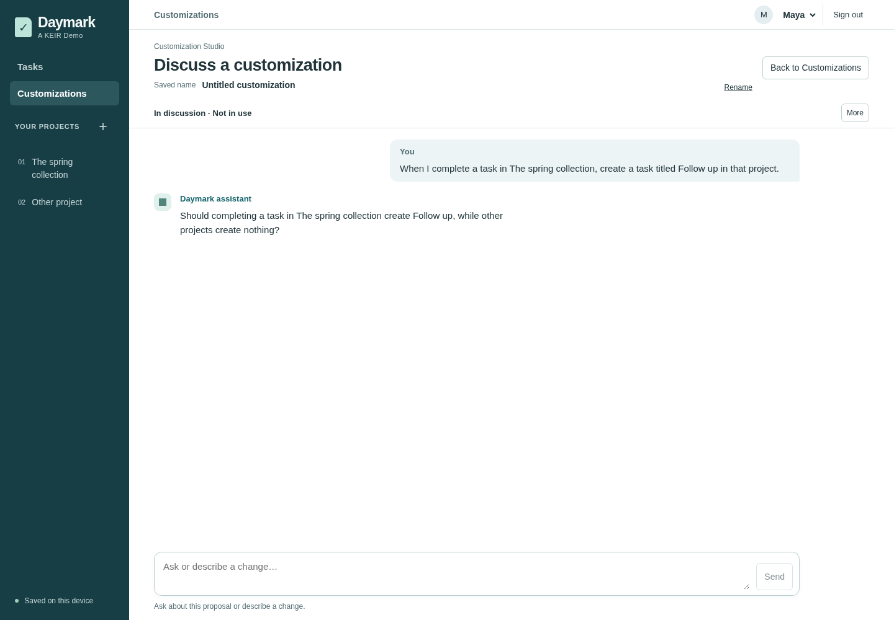
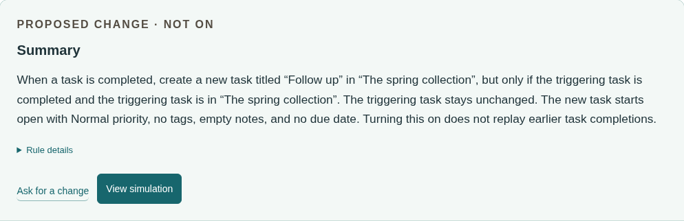
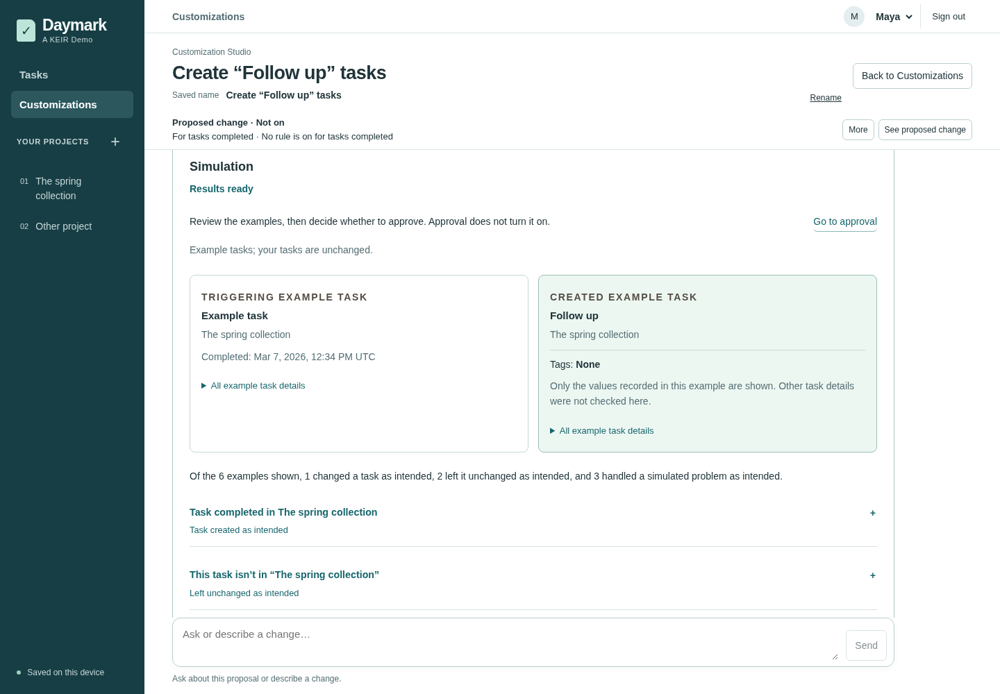
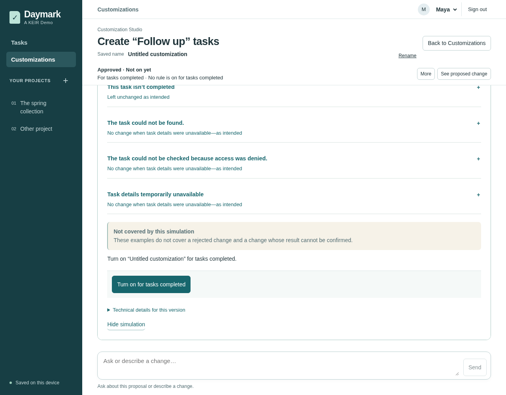
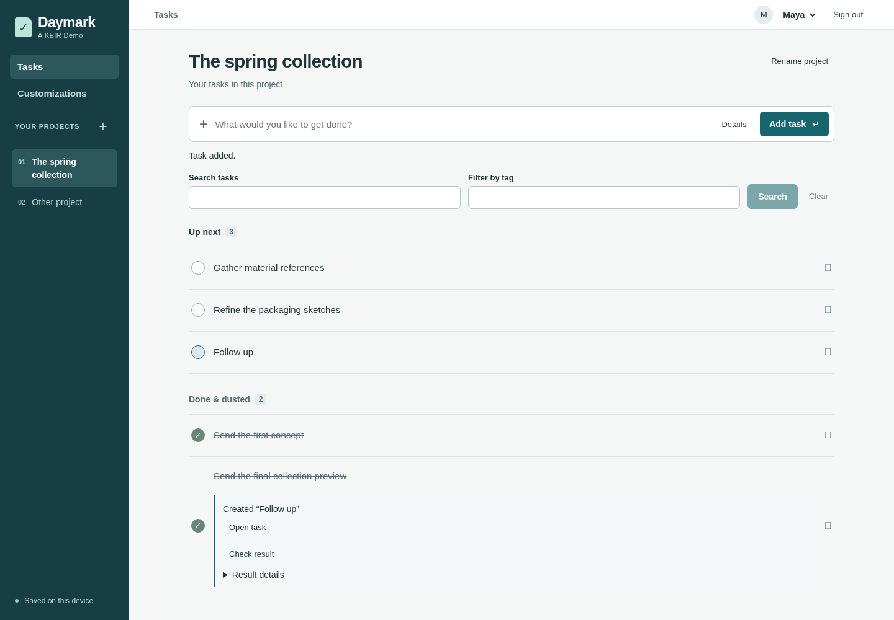
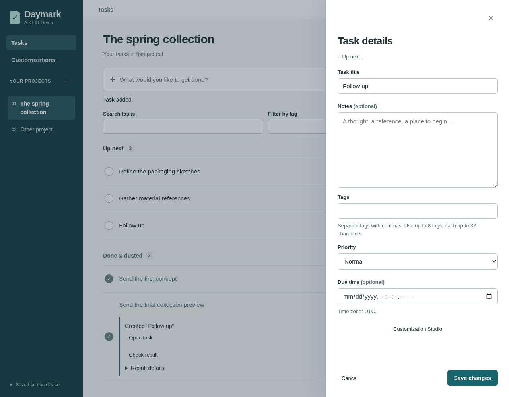

# Walkthrough: create a follow-up when a task is completed

Maya wants every completed task in **The spring collection** to leave her a new **Follow up** task in the same project. This tour follows that customization from a plain-language request to its saved result in Daymark. You can read it without running the app.

The screenshots show the app with fictional, disposable data. Authoring responses are scripted using the [offline fixture](../tests/README.md#offline-configured-ai-fixture); compilation, simulation, approval, activation and the native task writes are real. No paid AI requests were made for this tour.

To try it yourself, [run Daymark locally](../README.md#run-locally), have **Java 21** available, choose **Maya**, and [configure an AI provider](ai-authoring.md#configure-a-provider). Provider requests can incur charges, and the conversation may differ. Use a fresh demo workspace and add a second project, such as **Other project**, to try the nonmatching behavior too.

## 1. Describe the change

Open **Customizations** → **New customization** and send:

> When I complete a task in The spring collection, create a task titled Follow up in that project.

The assistant asks whether this should apply only to that project. Confirm the boundary: **create Follow up after a completion in The spring collection; other projects should create nothing**.

*The conversation establishes when to act, what to create, and where it belongs.*

## 2. Read the proposed behavior

When the assistant offers checked results, choose **See proposed change**. **Summary** separates **When**, **Only when** and **Then** so you can check the proposed behavior at a glance. Here, the triggering task must be completed and belong to **The spring collection**. The new task starts open, with Normal priority, no tags, empty notes and no due date. The completed task stays unchanged. **Rule details** keeps the full explanation available.

Choose **Rename** if you want a more useful saved name. You can use the suggested name, edit it, and choose **Save**. A suggestion changes nothing until you save it; an existing name stays yours to keep or change. This tour saves **Create “Follow up” tasks**.

*Use **Ask for a change** if the proposal differs from your goal.*

## 3. Check the examples and approve

Choose **View simulation**. Compare the intended action with what actually happened in each simulated situation. The matching example shows the task that started the rule alongside the separate **Created example task**. The new task's title, project and tags are recorded here; its other details were not checked by this example. The app's usual defaults in Summary describe what the task service does, rather than additional values verified by this simulation.

Open the individual examples to read their intended and observed results. A task completed in **Other project** creates nothing. The remaining examples check an open task and missing, denied or temporarily unavailable task details.

These are example tasks and simulated service responses: **your real saved tasks are unchanged**. A passing example means its observed result matched its expectation; an unavailable-task example can pass by correctly making no change.

*After reading the examples and coverage limits, **Go to approval** takes you to **Approve this change**. Choose it only when the checked proposal matches your intent. Approval records agreement to this exact version and its saved checks.*

## 4. Turn it on separately

After approval, the status is **Approved · Not on yet**. Choose **Turn on for tasks completed** to use it for future matching completions. If another customization is selected for that trigger, Daymark names what will be replaced; the previous customization stays saved.

*Approval and activation are separate decisions. Turning it on does not change saved tasks or replay earlier completions.*

## 5. Complete a matching task in the app

Return to **Tasks** and select **The spring collection**. Add **Send the final collection preview**, then select its completion circle. Daymark runs the approved Keir program for this new event and saves the result through its native task service. Execution needs no further AI request.

*The completed task’s **Customization outcome** now reports a real creation, separately from the original completion.*

## 6. Open the saved result

Choose **Open task** in the outcome. The new **Follow up** opens in the ordinary **Task details** form. It is an open, saved task in the same project, ready to edit or work on; it also remains in the task list after reload.

*The result is part of the task workspace, beyond the earlier simulation preview.*

Completing a task in **Other project** leaves it completed and creates no follow-up. This simple rule does not check for an existing open **Follow up**: each later matching completion can create another, including completing a follow-up itself. Merely creating the follow-up does not trigger this completion rule.

## Changes and recovery

Opening a saved customization or earlier messages sends no AI request. A changed proposal needs fresh checks and approval; the version already on keeps running until you explicitly replace it. Approval alone never turns it on.

An unknown effect means a task may already have changed. Use **Check result** and the available readback before another action; do not repeat task completion to retry a reaction. Cancellation cannot undo a committed write. After a lost authoring response, inspect the original saved request and use its offered recovery rather than sending a replacement paid turn.

For saved evidence and native execution guarantees, see the [host integration reference](read-extension-lifecycle.md).

## More examples

Use the same describe → check examples → approve → turn on sequence for these rules. Each has its own checked revision and trigger selection; approving a rule never turns it on.

### Avoid another follow-up

> When a high-priority task in The spring collection is completed, check for an open task titled Follow up in that project. Create one only if none is open. Other priorities and projects should do nothing. If the check is unavailable, create nothing.

**Avoid another follow-up** is an editable starting point in **New customization**. Check these cases before approving it:

| Situation | Expected behavior |
| --- | --- |
| High priority, chosen project, no open Follow up | Look for a match, then create Follow up. |
| Same situation with an open Follow up | Look for a match; create nothing. |
| Normal priority or another project | Skip the lookup and create nothing. |
| Task details or lookup unavailable | Report the failed check; create nothing. |

Turn it on for **tasks completed**. Add and complete a High-priority task in the chosen project; inspect **Customization outcome** and **Open task**. Completing another while Follow up is open creates nothing. Completing the Normal-priority follow-up itself does not match this rule.

This demonstrates using an operation's returned answer in a condition. Skipping a lookup supplies no answer, and a failed lookup is not evidence that no match exists. The title match is exact and case-sensitive. It is a snapshot, not a uniqueness reservation: simultaneous eligible completions can both create follow-ups.

### Require notes for many tags

> Before saving a new task with more than three tags, require notes.

This example uses the **unpublished numeric candidate** staged in this checkout. It counts the list the host supplies, not a database total; it is not a feature of the published packages. See [package provenance](package-provenance.md) for the exact dependencies.

| New task | Expected decision |
| --- | --- |
| Up to three distinct tags, no notes | Allow normal saving checks to continue. |
| Four through eight tags, no notes | Ask for notes; save nothing. |
| Four through eight tags, non-whitespace notes | Allow normal saving checks to continue. |
| Required check unavailable | Stop saving; distinguish this from rejection by the rule. |

Daymark trims, normalizes and lowercases tags before counting distinct values: `Client, client, REVIEW, internal` counts as three. Whitespace-only notes do not count. The app's own eight-tag maximum still applies; nine distinct tags fail native validation before the rule runs.

After reviewing the examples, approve and separately choose **Turn on for new tasks**. In **Tasks → Details**, submit four tags without notes. Your entries stay in the form. Add notes and submit the correction to save once. Quick-add and Enter use the same check. It applies to future creation, including automation, not to later edits of existing tasks. An allowed check still needs native permission and validation; it is not a save receipt. After a lost response, check the original attempt before creating another.

## About these examples

The screenshot journey and automated example journeys use scripted authoring responses with the real compiler, simulator and native services. They do not establish live-model compatibility. [Screenshot provenance](images/walkthrough/provenance.md) records the images; [verification](../tests/README.md) describes test boundaries.
